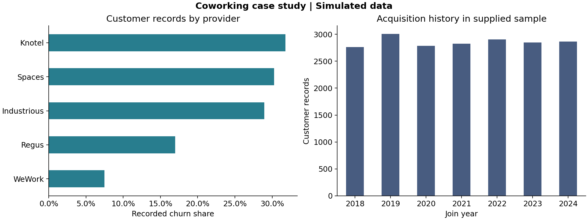

# Coworking Space Market Analysis and Churn Benchmark

A reproducible Python and Power BI portfolio case study using **simulated data**. Provider names are labels, not verified claims about actual businesses.



## Results

- 20,000 customers; 3,913 labelled churned: **19.565% recorded churn share**.
- 268,744 source usage rows; one incomplete final row is quarantined, leaving 268,743.
- 4,979 surveys; 470 occur after customer exit. Survey dates extend to 2027 while usage/exits end in August 2025. No common observation date is documented.
- 106 team sizes exceed the review threshold of 100 (maximum 29,096). Values remain unchanged and flagged.
- Logistic regression on 5,000 held-out customers: ROC AUC **0.6757**, average precision **0.2873**, accuracy **0.8042**, recall **0** at threshold 0.5. Majority baseline: accuracy **0.8044**, ROC AUC **0.5**, average precision **0.1956**. High accuracy mainly reflects class imbalance.

Recorded churn share means sum of Churned divided by customer records. It is not monthly churn or period retention. No causal pricing/amenity effect, switching pattern, actual market share or measured business uplift is established.

## Reproduce

Use Python 3.13. From this folder on Windows:

```powershell
python -m venv .venv
.venv/Scripts/python -m pip install -r requirements.txt
.venv/Scripts/python analysis.py
.venv/Scripts/python -m unittest discover -s tests -v
.venv/Scripts/python repair_powerbi.py
.venv/Scripts/python -m nbconvert --to notebook --execute "Co-working space jupyter.ipynb" --output executed.ipynb --ExecutePreprocessor.timeout=300
```

On macOS/Linux use `.venv/bin/python`. The notebook is supplied with executed outputs. Open it in a Jupyter-compatible editor and select this environment to work interactively. No cell installs packages or changes to the author's desktop folder. The script resolves paths from its own location.

Dependencies are pinned to locally tested versions, not a complete transitive lock. A GitHub Actions workflow repeats tests, analysis and notebook execution after authorized publication; no remote CI run is claimed.

## Files

| File | Purpose |
| --- | --- |
| `Co-working space jupyter.ipynb` | Narrative, validation, chart and benchmark |
| `analysis.py` | Shared validation, preparation and analysis |
| Four root CSVs | Unchanged source inputs |
| `data/prepared/` | Generated exports, excluding incomplete usage record |
| `reports/validation.json` | Counts, chronology, input SHA-256 hashes, versions |
| `reports/quarantined_usage.csv` | Excluded record, source line and reason |
| `reports/review_flags.csv` | Retained records requiring interpretation |
| `reports/model_metrics.json` | Holdout metrics and confusion matrices |
| `reports/test_predictions.csv` | Holdout IDs, labels and probabilities |
| `powerbi/` | Template candidate, readable sources and Desktop checks |
| `Visuals.pbix`, `Visuals.pbit` | Unchanged original Power BI files |
| `DATA_DICTIONARY.md` | Table grains, definitions and limitations |
| `REPAIR_REPORT.md` | Changes and validation scope |

## Model limits

Target: supplied Churned flag. Features: Company, Location, Monthly_Spend, Team_Size. Split: stratified 75/25, seed 42. Encoding, imputation and scaling fit training customers only. IDs, exits, exit-derived tenure, usage and surveys are excluded. Customers never overlap splits. No tuning or threshold selection uses test labels.

Spend/team-size availability before churn is undocumented, and follow-up differs between customers. This is **retrospective classification**, not validated future prediction. A future study needs dated snapshots, a forecast horizon, temporal evaluation, calibration and a threshold chosen on a separate validation set using intervention costs. Do not repeatedly tune on this holdout.

## Power BI

The GitHub CSV page is a data preview, not a dashboard. Download the complete project and follow [Power BI setup](powerbi/README.md). The original connections point to the author's desktop. The repaired template is a **candidate awaiting Desktop validation**. The embedded original PBIX model has not been refreshed or rewritten.

## Provenance

Source: [original repository](https://github.com/dhanyashrimarianna/Coworking-Space-Market-Analysis-Customer-Churn-Prediction), commit `2079b3fe1b4cced0f195749a0601cd1c728a51cf`. Its README identifies all data as simulated. No generation script, observation policy, currency definition, independent data citation or explicit license was supplied. This repair does not invent those details or grant a license. The internship description is preserved in original Git history; employment and employer endorsement are not independently verified.
